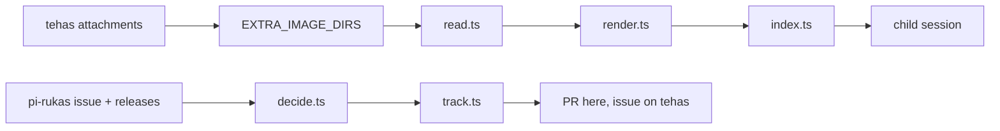
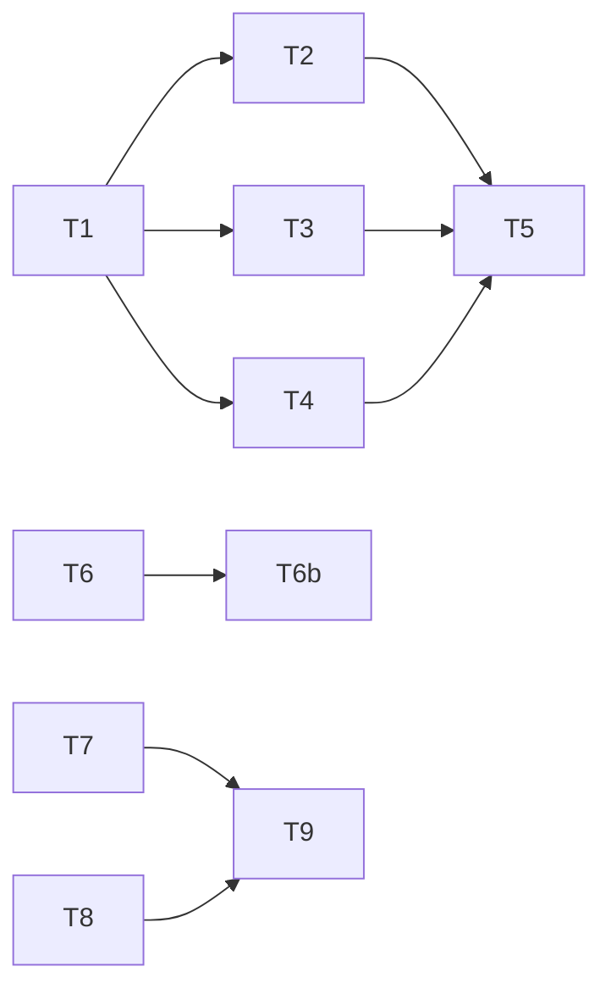

# Plan: issue-comments polyfill, and the tracking workflow

**Goal:** ship `packages/issue-comments` (a pi extension that turns the host's `comments.json` into one injected message) and `.github/workflows/track.yml` (PROCESS.md step 6), tested, so `v0.1.0` can be tagged.
**Spec:** docs/specs/2026-11-04-issue-comments-polyfill.md, S1..S9. S2..S7 are the contract; **S9 holds the exact reason strings, regexes, block and cap definition, and every type shape** — read it before writing code.

**Detail:** tests

**Target-min:** 32

**Ignore:** node_modules, .superlite, .claude, .pi

**Tech stack:** TypeScript under bun 1.4, `bun test`, no runtime dependency; `@earendil-works/pi-coding-agent` as a devDependency for types only. Test command: `bun test packages/issue-comments scripts/test`.

## Package issue-comments

App type: file I/O over a library core. Categories: file, encoding, deep. Risks: a `file` name escaping its directory, a symlink read, a size or sha lie, invalid UTF-8 and NUL, a cut inside a surrogate pair, the cap off by one block, two directories matching, the hook firing twice or on a custom message.
**Probe entry:** `call=collectComments(env) · run=bun test packages/issue-comments`

### T1 skeleton · Complexity 2 (O-1) · Est. context 24k
**Kind:** mechanical · **Model:** haiku
**Owns:** package.json, tsconfig.json, .gitignore, CHANGELOG.md, README.md, packages/issue-comments/package.json, packages/issue-comments/polyfill.json, packages/issue-comments/types.ts, packages/issue-comments/test/helpers.ts, packages/issue-comments/test/helpers.test.ts
**Components:** 2 · **LOC owned:** 150 · **Tests:** fast · **Est. time:** 3 min
**Produces:** writeFixture(o: FixtureOpts) -> FixturePaths
- e.g. `writeFixture({dir: "/tmp/a", manifest: {issue: 42, comments: {file: "comments.json", bytes: 4, sha256: "b3f0"}}, blobItems: []}) -> {dir: "/tmp/a", manifestPath: "/tmp/a/manifest.json", blobPath: "/tmp/a/comments.json"}`
- e.g. `writeFixture({dir: "/tmp/b", manifest: {issue: 42}, blob: null}) -> {dir: "/tmp/b", manifestPath: "/tmp/b/manifest.json", blobPath: ""}` (no blob written)
**Review Focus:** `test_fixture_sha_matches_bytes`; `test_symlink_option`; `test_raw_bytes`.
**Notes:** types.ts holds every package type listed in spec S9. CHANGELOG.md records `v0.1.0` with both packages. The root README table row for `issue-comments` reads `active`.

### T2 blob reader · Complexity 5 (O-1) · Est. context 28k
**Owns:** packages/issue-comments/read.ts, packages/issue-comments/test/read.test.ts
**Components:** 1 · **LOC owned:** 140 · **Tests:** fast · **Est. time:** 5 min
**Consumes:** writeFixture(o: FixtureOpts) -> FixturePaths (T1)
**Produces:** imageDirs(env: NodeJS.ProcessEnv) -> string[] · readDirComments(dir: string) -> ReadOutcome · collectComments(env: NodeJS.ProcessEnv) -> CollectOutcome
- e.g. `imageDirs({PI_ENSEMBLE_EXTRA_IMAGE_DIRS: "/a:/b"}) -> ["/a", "/b"]`
- e.g. `readDirComments(dirWithBadSha) -> {ok: false, reason: "sha256 mismatch"}`
- e.g. `collectComments({}) -> {ok: false, reason: "no dirs"}`
- e.g. `collectComments({PI_ENSEMBLE_EXTRA_IMAGE_DIRS: "/tmp/a:/tmp/b"})`, both matching -> `{ok: false, reason: "ambiguous", dirs: ["/tmp/a", "/tmp/b"]}`
**Review Focus:** `test_file_name_escapes_directory` (`"../secret.json"`, `"/etc/passwd"` -> `bad file name`); `test_symlink_rejected`; `test_wrong_size`; `test_nul_and_bad_utf8`; `test_issue_mismatch`; `test_no_comments_entry`; `test_two_matching_manifests`; `test_images_off_still_reads`.
**Notes:** integrity is checked against the file's own bytes: `lstat` (regular file, not a symlink), size against `bytes`, sha256 of the read bytes against `sha256`, then `new TextDecoder("utf-8", {fatal: true})` and a `\u0000` scan.

### T6b probe fixtures · Complexity 1 (O-1) · Est. context 18k
**Kind:** mechanical · **Model:** haiku
**Owns:** scripts/fixtures/capabilities/v0.14.0.ts, scripts/fixtures/capabilities/v0.14.50.ts, scripts/test/fixtures.test.ts
**Components:** 1 · **LOC owned:** 60 · **Tests:** fast · **Est. time:** 2 min
**Consumes:** -
**Produces:** fixtureSources() -> Record<string, string>
- e.g. `fixtureSources()["v0.14.0"]` -> the text of `scripts/fixtures/capabilities/v0.14.0.ts`, which declares no `issueComments`
**Review Focus:** `test_fixtures_match_upstream`: each fixture's `HEADLESS_FEATURES` keys are a subset of the keys in the real file at that tag (`gh api repos/trail-openers/pi-rukas/contents/extension/src/headless/capabilities.ts?ref=<tag>`); `test_only_the_synthetic_entry_says_lists`: only `v0.14.50.ts` declares `issueComments: true`, and that line is marked synthetic in a comment.
**Notes:** the two fixtures came from T6's ruling fix and are owned here so a checkpoint can record them. Call `probeReleases` from `scripts/capability_probe.ts` as shipped — its second argument is `Record<string, string>` of decoded source text, which is the T6 ruling, not the signature the frozen T6 block prints. Verify the fixtures against upstream; if an excerpt drifted, refresh it from the tag rather than editing it by hand.

### T3 rendering · Complexity 6 (O-1) · Est. context 25k
**Owns:** packages/issue-comments/render.ts, packages/issue-comments/test/render.test.ts
**Components:** 1 · **LOC owned:** 160 · **Tests:** fast · **Est. time:** 6 min
**Produces:** validItem(item: unknown) -> CommentItem | undefined · renderComments(blob: CommentsBlob) -> Rendered
- e.g. `validItem({source: "issue-comment", id: 1, by: "alice", at: "2026-11-03T09:00:00Z", url: "https://x.io/1", text: "hi"}) -> the same object`
- e.g. `validItem({source: "review-comment", id: 2, by: "bob", at: "2026-11-03T09:00:00Z", url: "https://x.io/2", text: "hi", pr: 57, path: "a.rs"}) -> undefined` (no `line`)
- e.g. `renderComments({version: 1, issue: 42, until: "2026-11-04T10:12:00Z", items: [oneItem]}) -> {text: "<header>\n\n### Issue comment by alice, 2026-11-03T09:00:00Z (https://x.io/1)\n\n> hi", count: 1, bytes: 71, dropped: 0}`
**Review Focus:** `test_cut_at_4000_keeps_surrogate_pair` (`"a".repeat(3999) + "\u{1F600}"` cuts at 4,000 characters ending ` […]`, no lone surrogate); `test_cap_drops_oldest_and_counts` (30 items of 3,000 characters: newest kept, `bytes` at most 65,536, dropped line present); `test_cap_boundary_exact`; `test_order_at_then_id`; `test_labels_for_every_source`; `test_malformed_items_dropped` (`by: ""`, `url: "http://x.io"`, `id: 1.5`, a string item: absent from `text`, counted in `dropped`).
**Detail:** full
**Notes:** empty `items` gives `{count: 0, bytes: 0, dropped: 0}` and the header alone; the caller sends no message then.
### T4 the extension · Complexity 4 (O-1) · Est. context 27k
**Owns:** packages/issue-comments/index.ts, packages/issue-comments/README.md, packages/issue-comments/test/extension.test.ts
**Components:** 2 · **LOC owned:** 120 · **Tests:** fast · **Est. time:** 4 min
**Consumes:** collectComments(env: NodeJS.ProcessEnv) -> CollectOutcome (T2) · renderComments(blob: CommentsBlob) -> Rendered (T3)
**Produces:** issueCommentsExtension(pi: ExtensionAPI) -> void
- e.g. `issueCommentsExtension(fake)` then `fake.fire("before_agent_start", {messageType: "user"})` with a valid fixture -> `{message: {customType: "issue-comments", content: "<rendered>", display: true}}`
- e.g. the same with `PI_ENSEMBLE_EXTRA_IMAGE_DIRS` unset -> `undefined`, nothing on stderr
**Review Focus:** `test_custom_message_gets_nothing`; `test_once_per_session`; `test_bad_blob_writes_stderr_and_returns_undefined` (`issue-comments polyfill: no comments (sha256 mismatch)`); `test_stderr_line_shape` (`issue-comments polyfill: 3 comments, 214 bytes, 1 dropped`, nothing else); `test_io_error_never_escapes` (a `manifest.json` that is a directory).
**Notes:** `export default issueCommentsExtension`; the handler is wrapped in try/catch. README carries S5's three cannot-match lines, PROCESS.md step 5's install (`~/.pi/agent/extensions/issue-comments`, the `tehas.rukas.polyfills` label) and the skip-when-native rule.

### T5 integration · Complexity 3 (O-1) · Est. context 37k
**Owns:** packages/issue-comments/test/integration.test.ts
**Components:** 1 · **LOC owned:** 90 · **Tests:** fast · **Est. time:** 3 min
**Consumes:** collectComments(env: NodeJS.ProcessEnv) -> CollectOutcome (T2) · renderComments(blob: CommentsBlob) -> Rendered (T3) · issueCommentsExtension(pi: ExtensionAPI) -> void (T4) · writeFixture(o: FixtureOpts) -> FixturePaths (T1)
**Review Focus:** `test_end_to_end_six_sources` (one item per source, all six blocks oldest first, stderr `6 comments`); `test_two_dirs_one_matching`; `test_dir_without_manifest_is_skipped`.
**Notes:** the real modules only, no fakes; the seam task, run with `SUPERLITE_REAL=1` too.

## Package scripts

App type: CLI over a pure decision core. Categories: protocol, state, file, encoding. Risks: a duplicate PR or issue, a `gh` failure mid-run, comparing `v0.14.9` and `v0.14.10` as strings, a capabilities document with no `features`, a reminder filed twice.
**Probe entry:** `run=bun run scripts/track.ts --dry-run`

### T6 capability probe · Complexity 4 (O-1) · Est. context 28k
**Owns:** scripts/lib/releases.ts, scripts/capability_probe.ts, scripts/fixtures/capabilities/v0.14.0.json, scripts/fixtures/capabilities/v0.14.50.json, scripts/test/releases.test.ts, scripts/test/capability_probe.test.ts, .github/workflows/polyfill-tests.yml
**Components:** 2 · **LOC owned:** 170 · **Tests:** fast · **Est. time:** 5 min
**Produces:** releaseTags(from: string, tags: string[], max: number) -> string[] · probeReleases(pkgs: PolyfillRecord[], docs: Record<string, unknown>) -> ProbeRow[]
- e.g. `releaseTags("v0.14.0", ["v0.13.9", "v0.14.0", "v0.14.9", "v0.14.10", "v1.0.0"], 3) -> ["v1.0.0", "v0.14.10", "v0.14.0"]`
- e.g. `releaseTags("v0.14.0", ["v0.13.9"], 12) -> []`
- e.g. `probeReleases([activeIssueComments], {"v0.14.0": {version: "0.14.0", features: {issueComments: true}}}) -> [{tag: "v0.14.0", package: "issue-comments", state: "active", lists: true, fail: true}]`
**Review Focus:** `test_version_order_not_string_order`; `test_from_always_included`; `test_missing_features_object` (`lists: false, fail: false`); `test_native_and_active_is_a_failure` (`fail: true`, the line names the tag and the package); `test_released_state_is_silent`.
**Notes:** `capability_probe.ts` takes `--from <tag> --max <n> --fixtures <dir>`; with `--fixtures` it reads `<dir>/<tag>.json` offline, without it it lists releases and reads each release's document through `gh`, printing one line per release, exiting 2 on any `gh` failure and 1 on any `fail: true`. The workflow runs on push and pull_request: `bun install`, `bun run test`, `bun run scripts/capability_probe.ts`.

### T7 tracking decision · Complexity 6 (O-1) · Est. context 25k
**Owns:** scripts/lib/decide.ts, scripts/test/decide.test.ts
**Components:** 1 · **LOC owned:** 170 · **Tests:** fast · **Est. time:** 6 min
**Produces:** decidePackage(pkg: PolyfillRecord, up: UpstreamState, contained: string[], ageDays: number, open: OpenTitles) -> TrackAction[] · containsCommit(status: string) -> boolean
- e.g. `decidePackage(activePkg, {state: "closed", mergedPr: {number: 2100, mergeCommit: "abc123"}}, [], 10, {prs: [], issues: []}) -> [{kind: "pr-merged", title: "issue-comments: upstream merged (pi-rukas#2020)", body: <string>, patch: {state: "merged", pr: 2100}}]`
- e.g. `decidePackage(mergedPkg, {state: "closed", mergedPr: {number: 2100, mergeCommit: "abc123"}}, ["v0.15.0"], 40, {prs: [], issues: []}) -> [{kind: "pr-released", patch: {state: "released", until: "v0.15.0"}}, {kind: "issue-retire", title: "Retire polyfill issue-comments: pi-rukas v0.15.0 ships trail-openers/pi-rukas#2020"}]`
- e.g. `decidePackage(activePkg, {state: "open", mergedPr: null}, [], 90, {prs: [], issues: []}) -> [{kind: "issue-reminder", title: "Polyfill issue-comments is still active after 90 days"}]`
- e.g. `containsCommit("behind") -> true`, `containsCommit("identical") -> true`, `containsCommit("ahead") -> false`
**Review Focus:** `test_open_upstream_does_nothing` (open, no merged PR, 30 days -> `[]`); `test_declined_when_closed_without_merge` (`pr-declined` plus `issue-decide`); `test_reminder_once` (an open reminder title gives `[]`); `test_reminder_only_for_active`; `test_released_wins_over_reminder`; `test_merged_needs_a_release_to_go_released`.
**Notes:** `contained` is the release tags whose compare status was `behind` or `identical`, oldest first; the first becomes `until`. A `merged` package already carrying `until` returns `[]`.

### T8 state and idempotence · Complexity 4 (O-1) · Est. context 26k
**Owns:** scripts/lib/types.ts, scripts/lib/state.ts, scripts/test/state.test.ts
**Components:** 1 · **LOC owned:** 120 · **Tests:** fast · **Est. time:** 4 min
**Produces:** readPackages(root: string) -> PolyfillRecord[] · trackedPackages(root: string) -> PolyfillRecord[] · applyPatch(content: string, patch: Record<string, unknown>) -> string · alreadyOpen(open: string[], title: string) -> boolean · firstCommitAgeDays(repo: string, path: string, now: Date) -> number
- e.g. `trackedPackages(repoRoot) -> [{name: "issue-comments", state: "active", from: "v0.14.0", upstreamIssue: "trail-openers/pi-rukas#2020", upstreamFeature: "issueComments", pr: null, until: null}]`
- e.g. `applyPatch('{"name": "x", "state": "active", "pr": null}', {state: "merged", pr: 2100}) -> '{"name": "x", "state": "merged", "pr": 2100}\n'`
- e.g. `firstCommitAgeDays(repo, "packages/issue-comments/polyfill.json", new Date("2026-12-04")) -> 30`
**Review Focus:** `test_unreadable_polyfill_json` (no package, one stderr line naming the file, no throw); `test_states_outside_scope`; `test_patch_keeps_key_order_and_two_space_indent`; `test_age_from_first_commit`.
**Notes:** `alreadyOpen(open, title)` is an exact title match against the open PR or issue titles. `firstCommitAgeDays` runs `git log --reverse --format=%ad --date=iso-8601 -- <path>` and takes the first line.
### T9 gh calls and the entry · Complexity 4 (O-1) · Est. context 48k
**Kind:** mechanical · **Model:** haiku
**Owns:** scripts/lib/forge.ts, scripts/track.ts, scripts/test/track.test.ts, .github/workflows/track.yml
**Components:** 2 · **LOC owned:** 150 · **Tests:** fast · **Est. time:** 4 min
**Consumes:** decidePackage(pkg: PolyfillRecord, up: UpstreamState, contained: string[], ageDays: number, open: OpenTitles) -> TrackAction[] (T7) · containsCommit(status: string) -> boolean (T7) · trackedPackages(root: string) -> PolyfillRecord[] (T8) · applyPatch(content: string, patch: Record<string, unknown>) -> string (T8) · alreadyOpen(open: string[], title: string) -> boolean (T8) · firstCommitAgeDays(repo: string, path: string, now: Date) -> number (T8)
**Produces:** runTrack(root: string, o: TrackOpts) -> number
- e.g. `runTrack(root, {dryRun: true, fetchUpstream: () => ({state: "open", mergedPr: null}), listOpen: () => ({prs: [], issues: []}), now: new Date("2026-11-24")}) -> 0` with stdout containing `issue-comments: nothing to do`
- e.g. the same with `fetchUpstream: () => ({state: "closed", mergedPr: {number: 2100, mergeCommit: "abc123"}})` -> `0` and the line `issue-comments: would open PR "issue-comments: upstream merged (pi-rukas#2020)"`
**Review Focus:** `test_dry_run_changes_nothing` (no file written, no shell call, one line per action); `test_idempotent_by_title`; `test_failure_exits_2_without_partial_write` (`polyfill.json` byte-identical); `test_no_tehas_label` (no argument list contains `tehas:`).
**Notes:** forge.ts shells out with `execFileSync` and a 60s timeout. track.yml: daily at 06:10 UTC plus `workflow_dispatch`, `permissions: {contents: write, issues: write}`, env `TEHAS_REPO=tehas-app/tehas` and `UPSTREAM_REPO=trail-openers/pi-rukas`, running `bun run scripts/track.ts`.
